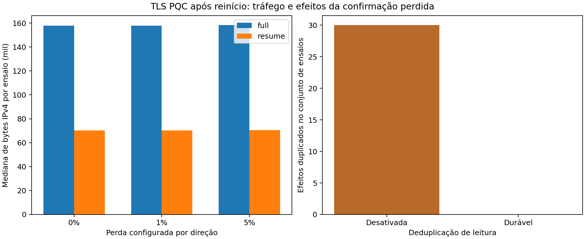

# Retomada Pós-Quântica após Reinícios em IoT: Estado de Sessão, Recuperação e Leituras Duplicadas

Autoria e afiliações: a preencher pelos pesquisadores.

Versão de trabalho para WQuNets, 14/10/2026. A organização segue o artigo de referência: Abstract, Resumo, seis seções, subseções 4.1/4.2 e 5.1/5.2/5.3. A hierarquia foi preservada e os títulos temáticos adaptados. O enquadramento na chamada, limite de páginas e comprovação da novidade permanecem pendentes.

## Abstract

Device restarts can restore obsolete cryptographic and application state in Internet of Things deployments. We evaluate session recovery under checkpoint rollback, protocol interruption, gateway context loss, and lost reading acknowledgements. A real-cryptography prototype provides negative controls for counter persistence and key renewal; a native TLS 1.3 implementation uses X25519MLKEM768 and ML-DSA-44 authentication. The evaluation includes 240 security traces, 330 protocol-interruption cases, and a Mininet-WiFi pilot with 60 conditions and 360 client processes. Warm TLS resumption reduces handshake bytes from 23,859 to 2,873, while gateway cache loss requires full authentication. Lost acknowledgements produce 30 duplicate database effects when suppression is disabled and none with a durable reading ledger. The results distinguish session confidentiality, recovery availability, and application deduplication. They support conditional benefits of resumption, without establishing a new cryptographic construction or protection against complete gateway rollback.

## Resumo

Reinícios de dispositivos podem restaurar estado criptográfico e de aplicação obsoleto em redes IoT. Este trabalho avalia recuperação de sessões diante de rollback de checkpoints, interrupções do protocolo, perda de contexto do gateway e confirmação de leitura perdida. Um protótipo com criptografia real fornece controles negativos de persistência e renovação de chaves; uma implementação nativa de TLS 1.3 emprega X25519MLKEM768 e autenticação ML-DSA-44. A avaliação inclui 240 traços de segurança, 330 casos de interrupção e um piloto Mininet-WiFi com 60 condições e 360 processos de cliente. A retomada quente reduz os bytes de handshake TLS de 23.859 para 2.873, mas perder o cache do gateway exige autenticação completa. Confirmações perdidas produzem 30 efeitos duplicados no banco quando a supressão está desativada e nenhum com ledger durável. Os resultados distinguem confidencialidade da sessão, disponibilidade da recuperação e deduplicação da aplicação, delimitando os benefícios da retomada ao estado que permanece disponível.

## 1. Introdução

Sensores podem reiniciar entre a produção de uma leitura e o recebimento de sua confirmação. Um checkpoint pode conservar informações suficientes para retomar comunicação, mas também restaurar contadores ou decisões de entrega antigas. Com mensagens criptográficas maiores na transição pós-quântica, repetir autenticações completas aumenta o tráfego; reutilizar indiscriminadamente o contexto antigo pode comprometer a confidencialidade. A decisão de recuperação envolve, portanto, tanto estado criptográfico quanto estado da leitura.

A pergunta investigada é: sob quais condições de estado a retomada mantém comunicação autenticada, reduz custo e evita efeitos duplicados após reinícios? A hipótese operacional tem duas partes. Quando o contexto autenticado do gateway permanece disponível e há contribuição assimétrica nova, a retomada reduz bytes frente ao handshake completo da mesma suíte. Quando uma confirmação se perde após o processamento, uma sessão nova não elimina por si só a repetição do efeito; registrar a decisão da aplicação antes do ACK deve suprimir esse efeito enquanto o ledger permanecer atual.

A contribuição candidata é uma avaliação reproduzível que relaciona falhas de estado, custos de recuperação e garantias de aplicação. Construímos controles vulneráveis para observar reutilização de chave/nonce; avaliamos interrupções em diferentes pontos; e verificamos as conclusões de recuperação e deduplicação com TLS nativo e tráfego efetivo no Mininet-WiFi. Não propomos primitivas novas nem atribuímos novidade à retomada PSK, à reserva de contadores ou à deduplicação. Os resultados são experimentais e a revisão ainda não estabelece prioridade da contribuição.

## 2. Fundamentação Teórica

ML-KEM e ML-DSA são padronizados em FIPS 203 e FIPS 204 [1, 2]. ML-KEM estabelece um segredo compartilhado; ML-DSA autentica mensagens. Na bancada TLS, o grupo híbrido X25519MLKEM768 combina contribuições clássica e pós-quântica, enquanto certificados ML-DSA-44 autenticam o handshake completo. A comparação de desempenho usa a mesma configuração TLS nos dois modos; não equiparamos esse grupo ao ML-KEM-512 do protótipo.

AES-GCM exige que um IV não seja repetido sob a mesma chave [3]. Restaurar uma chave de tráfego e seu contador pode repetir o par chave/nonce, mesmo que o receptor rejeite a mensagem como replay. Persistir contadores antes do uso ou reservar blocos pode proteger contra perda de energia com journal atualizado. Restaurar também o journal elimina essa garantia. OSCORE já discute perda de estado e recuperação de contexto [4]; tais mecanismos são antecedentes.

TLS 1.3 permite retomada baseada em PSK e incorporação de contribuição assimétrica nova [5]. O ticket pode representar uma referência a um cache do servidor ou estado protegido por chave do servidor. Nossa implementação escolhe cache stateful em RAM: um reinício do gateway perde a autoridade de retomada e exige handshake completo. Na sessão retomada, a identidade deriva da sessão previamente autenticada; não há nova assinatura de certificado em cada conexão. 0-RTT está desabilitado.

Autenticação de um registro e entrega única de uma leitura são propriedades diferentes. Após processar uma leitura sem que o cliente receba o ACK, o servidor pode receber novamente o mesmo conteúdo em uma sessão nova válida. Um identificador estável permite reconhecer a repetição. Neste trabalho, “efeito” significa inserção em uma tabela SQLite, não execução exatamente uma vez de uma ação externa.

## 3. Trabalhos Relacionados

Avoine, Canard e Ferreira apresentam AKE com retomada e forward secrecy empregando funções simétricas no dispositivo e no backend [6]. Seu protocolo evolui chaves; ele não é equivalente ao controle com PSK estático retido que usamos para demonstrar recuperação de texto após exposição tardia. Esse resultado negativo não deve ser generalizado a todos os protocolos simétricos de retomada.

KEMTLS-PDK explora chaves públicas previamente distribuídas para reduzir custos de autenticação pós-quântica [7]. Na cópia dos autores de junho de 2021, a discussão delimita a ausência de comparação com retomada TLS PSK combinada com DH/KEM para forward secrecy. Essa delimitação pertence àquele texto, não estabelece ausência de avaliações posteriores. Nosso experimento não implementa PDK e não demonstra superioridade em relação a ele.

Scott estuda TLS para IoT e sua migração pós-quântica [8]. Foram conferidos abstract e metadados, mas a leitura integral da revisão de 2024 permanece pendente. Assim, não atribuímos ao presente trabalho uma lacuna baseada em suposta ausência de reinícios naquele artigo. Hebrok et al. analisam riscos de tickets TLS em implementações e implantações [9]. Seu estudo reforça a necessidade de especificar proteção e disponibilidade do estado; nossos fallbacks de cache em RAM não representam todos os servidores TLS.

O diferencial pretendido é integrar controles de rollback, interrupções, estado perdido no gateway e efeito da confirmação perdida em uma avaliação com artefatos verificáveis. A [revisão dirigida](revisao_retomada.md) registra quais textos foram efetivamente lidos e os limites da comparação. Uma afirmação de ineditismo exige fechamento dessa revisão e confronto com um antecedente próximo.

## 4. Estratégia de Recuperação de Sessão e Estado da Leitura

### 4.1. Modelagem do Problema

Consideramos um sensor e um gateway com identidades provisionadas. O sensor produz leituras sintéticas identificadas por dispositivo e ID. O cliente pode reiniciar e restaurar um checkpoint antigo; a rede pode perder pacotes; o gateway pode reiniciar perdendo seu contexto criptográfico em RAM. A decisão de aplicação permanece em armazenamento durável quando explicitamente preservado no cenário.

O atacante funcional dos controles pode reproduzir registros e checkpoints antigos ou adulterar conteúdo. Entropia nova e credenciais de identidade permanecem fora do rollback ordinário do cliente. Rollback simultâneo de toda a memória do sensor e do gateway, extração completa de credenciais, canais laterais e garantia física de apagamento não são resolvidos. A segurança do ledger depende de ele não ser restaurado para uma versão antiga.

Separamos três critérios: ausência de reutilização de chave/nonce no protótipo instrumentado; recuperação autenticada após um evento de falha seguido de tentativa sem nova interrupção; e ausência de efeitos duplicados no banco com ledger preservado. No TLS, não exportamos chaves/IVs internos. Verificamos parâmetros negociados, identidade, retomada efetiva e key_share público novo; isso não é observação direta de todos os pares chave/nonce.

Os custos também são separados: mensagens de handshake enquadradas no protótipo; registros TLS até o retorno de SSL_connect; tráfego IPv4 total observado por ensaio; retransmissões TCP nos endpoints; tempo de confirmação após TCP conectado e recuperação desde o disparo do processo. Não usamos esses tempos como tempo de boot de ESP32.

### 4.2. Estratégia de Recuperação

O protótipo inclui checkpoint de chave/contador, persistência antes de cada uso, reserva de blocos e três modos com chave nova: autenticação completa, retomada PSK e retomada com ML-KEM novo. Nos modos com chave nova, o arquivo autenticado conserva a raiz de retomada, não a chave antiga de tráfego. Estado inválido ou contexto perdido aciona autenticação completa, cujo custo entra na recuperação.

O backend padronizado usa OpenSSL 3.5.9, TLS 1.3, AES-256-GCM, X25519MLKEM768 e autenticação mútua ML-DSA-44. O cliente salva a sessão DER em checkpoint AES-GCM vinculado à CA e ao nome do servidor. O timeout é 3600 s e 0-RTT permanece desabilitado. Um módulo C mínimo expõe as operações TLS nativas ao Python; o projeto não substitui a derivação de chaves do OpenSSL.

Para a aplicação, o gateway executa uma transação SQLite com WAL e synchronous=FULL antes de enviar o ACK. Um ID novo registra leitura e efeito; ID e conteúdo idênticos retornam confirmação de repetição sem novo efeito; ID igual com conteúdo diferente gera conflito. O controle desativa a supressão, conservando rastreamento para auditoria. A transação torna leitura e efeito atômicos no banco. A persistência do ID pendente no sensor físico é requisito de implantação futura; as tentativas do piloto recebem o mesmo ID do controlador.

## 5. Avaliação e Resultados

### 5.1. Falhas de Estado

A primeira campanha executou seis políticas, quatro falhas e dez repetições, totalizando 240 traços. Cada traço possui oito leituras antes e oito após a falha. A instrumentação observa a cifragem antes da rejeição pelo receptor. Nos controles de checkpoint antigo e rollback completo do journal, houve repetição de chave/nonce e recuperação de texto sintético por relação entre ciphertexts. O gateway rejeitou registros repetidos, mas essa rejeição não removeu o vazamento no enlace.

| Política | Reusos após perda de energia com journal atual | Reusos após rollback completo | Reusos após rollback com chave nova |
|---|---:|---:|---:|
| Checkpoint de chave/contador | 80 | 80 | Não aplicável |
| Persistência por uso | 0 | 80 | Não aplicável |
| Reserva de blocos | 0 | 80 | Não aplicável |
| Completo, PSK ou ML-KEM novo | 0 por política | 0 por política | 0 por política |

Cada célula soma dez traços e oito leituras após a falha. Também passaram 65 verificações funcionais, incluindo controles vulneráveis com falha esperada. Esses números representam cenários executados, não uma prova estatística contra todo atacante. Um controle de rollback completo do banco demonstra que o ledger perde sua proteção se sua própria história for restaurada.

### 5.2. Garantias de Retomada

A segunda campanha totalizou 330 casos: onze pontos de falha, três modos com chave nova e dez repetições. Incluímos interrupções após mensagens do handshake, commit, checkpoint e cifragem, além de ACK perdido, checkpoint truncado e contexto perdido no gateway. As políticas com chave nova atenderam aos critérios registrados de recuperação e unicidade nos cenários testados. A aplicação sem ledger repetiu o efeito quando o ACK se perdeu.

A alegação de economia universal foi refutada: perder a raiz do gateway custou 9.568 bytes no caminho de retomada seguido de fallback, contra 9.263 no estabelecimento completo do protótipo, acréscimo de 3,29%. Com contexto disponível, foram 3.136 bytes na retomada com ML-KEM novo. São mensagens JSON/Base64 enquadradas, não bytes TLS.

No piloto TLS, o reinício do gateway provocou 30 handshakes completos nas condições de retomada. Restaurar um ticket antigo com gateway vivo permitiu 30 retomadas no último boot, com key_share novo. O controle com supressão desativada acumulou 30 efeitos duplicados; o ledger durável acumulou zero. A interpretação é condicionada: sessão nova protege a comunicação segundo o protocolo, mas não substitui a decisão persistente da aplicação.

### 5.3. Custos e Recuperação

O piloto usou um sensor Wi-Fi emulado e perdas netem independentes de 0%, 1% e 5% em ambos os sentidos do enlace AP–servidor, com atraso de 2 ms por sentido. Cinco blocos, dois modos TLS e dois modos de deduplicação produziram 60 condições. Cada condição teve cinco leituras e seis processos devido à repetição após ACK perdido: 300 entregas lógicas e 360 processos. Os IDs e cargas são repetidos entre comparadores; não há 300 amostras independentes de sensores. A ordem dos quatro comparadores rotaciona por bloco, mas as sequências aleatórias de perdas do kernel não são exatamente pareadas.

| Medida | Handshake completo | Retomada quente |
|---|---:|---:|
| Mediana de bytes TLS até SSL_connect, boot 1 | 23.859 | 2.873 |
| Redução nesse intervalo | Referência | 87,96% |

O intervalo não inclui tickets pós-handshake, cabeçalhos IP ou todas as tentativas do ensaio. A economia no handshake não deve ser apresentada como economia percentual do tráfego total nem como novidade do TLS. O [relatório e CSV do piloto](resultado_tls_piloto.md) registram bytes IPv4, medianas e extremos por configuração, contadores TCP e tempos de confirmação/recuperação.

Com deduplicação ativa, os custos observados por ensaio foram:

| Perda por direção | IPv4 completo (bytes) | IPv4 retomada (bytes) | ACK completo (ms) | ACK retomada (ms) | Segmentos TCP retransmitidos: completo / retomada |
|---|---:|---:|---:|---:|---:|
| 0% | 157.895 | 70.250 | 65,7 | 55,4 | 1 / 1 |
| 1% | 157.895 | 70.158 | 67,2 | 65,2 | 1 / 3 |
| 5% | 158.287 | 70.550 | 91,6 | 62,1 | 9 / 7 |

Os bytes e segmentos são medianas de cinco ensaios; os tempos são medianas das medianas de confirmações de cada ensaio. Cada ensaio inclui bootstrap, restart, recuperação de ACK e restauração do ticket. O modo completo realiza seis handshakes completos; o modo retomada realiza dois completos e quatro retomados. O contador também cobre encerramento TLS e interrupção deliberada; sua presença com 0% configurado não identifica perda causada pelo netem. A variação entre blocos e a ausência de perdas exatamente pareadas impedem atribuir superioridade estatística geral a esses tempos ou contagens.

Figura 1. Tráfego IPv4 por ensaio com deduplicação ativa e efeitos duplicados acumulados nas condições de ACK perdido. A captura é no servidor; seu volume representa bytes observados, não toda cópia descartada antes do ponto de captura.

Os PCAPs são auditados por sequência inicial TCP e hash do key_share do ClientHello, evitando confundir conexões que reutilizam a mesma porta. A cobertura deve ser contínua e coincidir com todos os bytes TLS em conexões confirmadas. Na interrupção deliberada, exige-se a captura integral da leitura, contabilizando separadamente um alerta terminal que pode não chegar. `TCP_INFO.tcpi_total_retrans` fornece segmentos retransmitidos nos dois endpoints antes do fechamento. Payload duplicado observado no PCAP é somente um limite inferior e permanece separado.

A suíte possui 82 testes de regressão. Integração TLS e controles negativos verificam retomada, fallback, CA e nomes incorretos, conflito de conteúdo e deduplicação após restart. Manifestos congelados antes das campanhas registram fontes, parâmetros e critérios. A [reprodução](tls_reproducao.md) identifica diretórios válidos e rodadas exploratórias excluídas.

São resultados descritivos de piloto com cinco blocos por configuração. Não inferimos P95 robusto, energia, ciclos de flash ou desempenho de ESP32. Há um backend TLS e uma política de tickets; cache/STEK persistentes podem alterar os resultados. Tampouco foi executada recuperação de TLS em todos os pontos internos do protocolo: a matriz de onze interrupções pertence ao protótipo. Mais dispositivos, perdas em rajadas, fila durável no sensor e gateways conjuntamente restaurados exigem avaliações adicionais.

## 6. Conclusão e Trabalhos Futuros

Os resultados sustentam a hipótese condicionada de que retomada com contexto disponível reduz bytes de handshake e de que estado durável de aplicação é necessário para suprimir os efeitos repetidos observados após ACK perdido. Eles refutam a economia universal diante de perda de contexto e mostram que rejeitar replay não corrige o vazamento causado por restaurar chave/nonce antigo. A proteção depende de distinguir o estado do cliente, a autoridade de retomada do gateway e a história das leituras.

O tema permanece viável como avaliação experimental de recuperação PQC, sujeito à comprovação do diferencial frente aos trabalhos próximos. Os próximos estudos devem comparar um antecedente implementado, ampliar blocos e condições com critérios estatísticos pré-definidos e avaliar uma fila durável no sensor. Medições em ESP32 poderão examinar armazenamento e energia; não são conclusões desta bancada. A submissão exige ainda revisão integral do antecedente pendente, definição de autoria e ajuste ao formato vigente do evento.

## Referências

[1] NIST. FIPS 203: Module-Lattice-Based Key-Encapsulation Mechanism Standard. 2024. [Publicação](https://csrc.nist.gov/pubs/fips/203/final).

[2] NIST. FIPS 204: Module-Lattice-Based Digital Signature Standard. 2024. [Publicação](https://csrc.nist.gov/pubs/fips/204/final).

[3] NIST. SP 800-38D: Recommendation for Block Cipher Modes of Operation: Galois/Counter Mode. 2007. [Publicação](https://csrc.nist.gov/pubs/sp/800/38/d/final).

[4] Selander et al. Object Security for Constrained RESTful Environments (OSCORE). RFC 8613. 2019. [Texto](https://datatracker.ietf.org/doc/html/rfc8613).

[5] Rescorla. The Transport Layer Security (TLS) Protocol Version 1.3. RFC 9846. 2026. [Texto](https://datatracker.ietf.org/doc/html/rfc9846).

[6] Avoine, Canard e Ferreira. IoT-Friendly AKE: Forward Secrecy and Session Resumption Meet Symmetric-Key Cryptography. ESORICS 2019, pp. 463–483. [Registro eprint](https://eprint.iacr.org/2019/911).

[7] Schwabe, Stebila e Wiggers. More Efficient Post-Quantum KEMTLS with Pre-Distributed Public Keys. ESORICS 2021. [Publicação dos autores](https://kemtls.org/publication/kemtlspdk/).

[8] Scott. On TLS for the Internet of Things, in a Post-Quantum World. ePrint 2023/095, revisão de 2024. [Registro](https://eprint.iacr.org/2023/095).

[9] Hebrok et al. We Really Need to Talk About Session Tickets: A Large-Scale Analysis of Cryptographic Dangers with TLS Session Tickets. USENIX Security 2023, pp. 4877–4894. [Publicação](https://www.usenix.org/conference/usenixsecurity23/presentation/hebrok).
