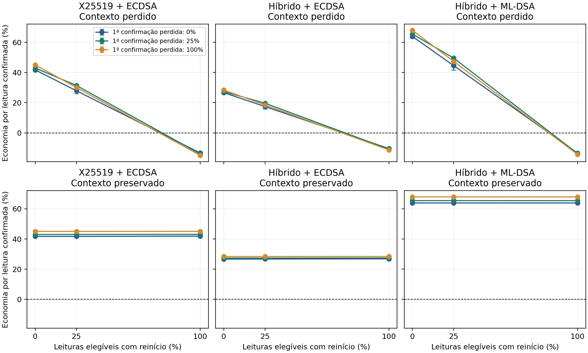
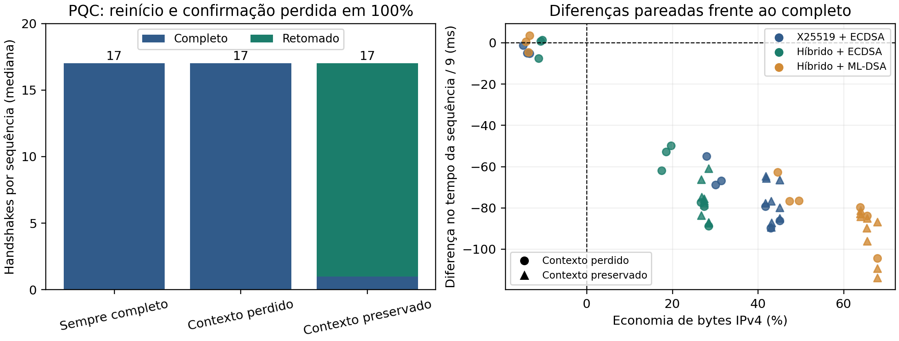

# Resultado da campanha ampliada de recuperação

Consolidação: 21/10/2026. **A economia universal da retomada foi refutada; preservar o contexto sustentou economia nas condições medidas.** A ampliação produziu uma caracterização comparativa, mas ainda não estabelece um mecanismo inédito nem permite prever aceite no SBRC.

## O que foi concluído

- Leitura integral de Catoni, Puliafito e Dini (2025), registrada em [comparacao_catoni_completa.md](comparacao_catoni_completa.md).
- Campanha principal: **1.620 ensaios**, dez blocos completos, três frequências de reinício, três de confirmação perdida, três perfis criptográficos, três tratamentos e dois modos de deduplicação.
- Robustez: **180 ensaios**, dez blocos por configuração, perdas de pacotes de 1%/5%, com reinício e confirmação perdida em 25% das leituras elegíveis e deduplicação ativa.
- Total: **1.800 ensaios, 16.200 leituras lógicas confirmadas e 21.960 processos/tentativas TLS**. Não houve leituras não confirmadas, watchdogs ou confirmações ausentes fora das injeções nas duas matrizes finais.
- Todos os ensaios incluídos passaram pela auditoria de parâmetros/identidade, compartilhamentos públicos novos, modo efetivo, cobertura dos bytes comprovadamente entregues e zero descartes no kernel da captura. PASS da instrumentação não significa que a hipótese de economia foi aceita.

Os arquivos definitivos são `results/raw/continuity_core_registered_20261021_v5` e `results/raw/continuity_loss_registered_20261021_v5`. A análise está em [resultados_continuidade_20261021_v5](resultados_continuidade_20261021_v5/audit.json). O piloto antigo de 60 condições e os seus fontes/dados continuam preservados; seus percentuais não foram misturados aos novos resultados.

## Comparação efetiva

Todos os perfis usam TLS 1.3, autenticação mútua, AES-256-GCM/SHA-384, identidades/CA verificadas e 0-RTT desabilitado. Alteram-se estabelecimento e autenticação:

| Perfil | Troca de chaves | Autenticação |
|---|---|---|
| Clássico | X25519 | ECDSA P-256 |
| Intermediário | X25519MLKEM768 | ECDSA P-256 |
| PQC | X25519MLKEM768 | ML-DSA-44 |

Os tratamentos são autenticação completa direta em cada tentativa, retomada com chave de proteção dos tickets perdida no reinício e retomada com essa chave preservada. As duas políticas de retomada usam a mesma construção de tickets sem cache por sessão. Assim, preservar estado não é confundido com trocar o formato do ticket.

Há nove leituras por ensaio: uma inicial sem falha e oito elegíveis. 25% significa duas dessas oito leituras; 100%, todas as oito. Reinícios ocorrem antes da leitura. A confirmação selecionada é suprimida após a gravação, encerrando abruptamente a conexão; a leitura é reenviada com o mesmo identificador. Esse evento é diferente de perder um pacote TCP, que pode ser retransmitido na mesma sessão. As agendas são iguais entre comparadores do bloco, mas as perdas do kernel não são exatamente pareadas. A ordem dos comparadores é aleatorizada.

## Resultado principal: o benefício muda de sinal

A tabela apresenta economia de **bytes IPv4 por leitura confirmada**, frente ao estabelecimento completo direto do mesmo perfil, com deduplicação ativa e netem 0%. Cada estimativa é a mediana de dez contrastes pareados por bloco. Colchetes são intervalos bootstrap percentis de 95%, exploratórios por célula, não simultâneos para todo o fatorial. Valores negativos representam aumento de custo.

| Reinícios | Confirmações perdidas | PQC: contexto perdido | PQC: contexto preservado |
|---|---|---|---|
| 0% | 0% | 63,88% [63,85; 63,91] | 63,90% [63,86; 63,93] |
| 25% | 25% | 49,56% [41,73; 49,59] | 65,43% [65,40; 65,45] |
| 100% | 0% | -13,37% [-13,44; -13,34] | 63,88% [63,84; 63,91] |
| 100% | 100% | -14,24% [-14,31; -14,15] | 67,87% [67,86; 67,90] |

Com falhas em 100% das leituras elegíveis, as medianas de bytes por leitura foram 57.489,44 no modo completo, 65.673,67 no volátil e 18.469,00 no preservado. Esses valores são medianas de custos; os percentuais acima são medianas dos contrastes dentro de cada bloco, não razões entre medianas agregadas.

Portanto, a afirmação “oferecer retomada sempre reduz tráfego” não sobreviveu. Preservar o contexto evitou repetir a autenticação completa, enquanto oferecer um ticket rejeitado acrescentou material à conexão que acabou executando essa autenticação. A retomada recusada não implica necessariamente dois handshakes TLS naquela tentativa: a negociação completa ocorre na mesma conexão, carregando o custo da oferta.

O fenômeno também existe no TLS clássico. No cenário de 100%/100%:

| Configuração | Contexto perdido | Contexto preservado |
|---|---|---|
| X25519 + ECDSA | -14,91% [-14,93; -14,87] | 45,07% [45,05; 45,12] |
| X25519MLKEM768 + ECDSA | -11,31% [-11,32; -11,29] | 28,42% [28,40; 28,44] |
| X25519MLKEM768 + ML-DSA | -14,24% [-14,31; -14,15] | 67,87% [67,86; 67,90] |

O perfil PQC possui a maior diferença absoluta entre políticas, mas a penalidade percentual do clássico pode ser maior. Não atribuir a existência do problema exclusivamente a PQC.

[Figura vetorial em PDF](resultados_continuidade_20261021_v5/economia_por_falhas.pdf). As linhas ligam apenas as três frequências medidas; não estabelecem uma curva validada nem um limiar exato para frequências intermediárias.

## O que explica o custo

A análise posterior de **todos os 21.960 ClientHello** mediu somente comprimentos de campos públicos, sem decifrar tickets ou exportar seu conteúdo:

| Perfil | Identidade PSK dentro do ClientHello | Acréscimo da extensão PSK |
|---|---:|---:|
| Clássico/ECDSA | 640 bytes | 703 bytes |
| Híbrido/ECDSA | 640–656 bytes | 703–719 bytes |
| Híbrido/ML-DSA | 4.240 bytes | 4.303 bytes |

Os ClientHello do perfil PQC mediram 1.368 bytes sem a extensão de retomada e 5.671 bytes com ela, incluindo o cabeçalho da mensagem de handshake. Isso explica parte importante da penalidade de apresentar credenciais de retomada que o servidor não consegue aceitar. O contraste associa o aumento à configuração de autenticação e estado do OpenSSL; não é uma decomposição comprovada de cada campo interno do ticket cifrado. A variação ECDSA e o alinhamento da proteção dos tickets impedem alegar isolamento exato em bytes de uma única primitiva.

A análise das contagens também explica o efeito conjunto das falhas. Se R é o número de reinícios e O o número de leituras que sofrem reinício e confirmação perdida, o volátil realizou `1 + R + O` handshakes completos em cada caso final. O preservado realizou um. O comparador direto realizou nove mais o número de confirmações suprimidas. A regra coincidiu com as contagens de todos os 1.800 ensaios, sem ajustes aos resultados.

No caso 100%/100%, completo e volátil realizaram **17 completos**, enquanto o preservado realizou **1 completo e 16 retomados**. Após a interrupção abrupta, a primeira tentativa completa não deixou uma sessão substituta utilizável no cliente; com a chave volátil, o ticket antigo continuou inválido na repetição. A variável observada é a disponibilidade de uma sessão utilizável, não a ausência de qualquer NewSessionTicket no tráfego. Não generalizar esse comportamento a um encerramento TLS normal ou à perda isolada de um pacote.

Um contraste exploratório de quatro cantos quantificou a não aditividade. No PQC 100%/100%, a combinação das falhas acrescentou **23.530,22 bytes por leitura** à vantagem da preservação além da soma dos efeitos isolados, intervalo [23.500,44; 23.558,22]. Em 25%/25%, a estimativa foi 28,89, intervalo [-28,00; 2.899,56], sem sustentação para uma interação diferente de zero nessa célula. Nessa agenda, somente três dos dez blocos tiveram uma leitura com ambas as falhas. Essa análise foi acrescentada durante a execução, é explicativa e não constitui hipótese confirmatória previamente registrada.

[Figura vetorial em PDF](resultados_continuidade_20261021_v5/handshakes_e_tempo.pdf). O painel temporal usa a duração da sequência até a última confirmação, dividida pelas nove leituras; não é latência de rede isolada nem P95.

## TLS clássico equivalente e custo da migração

Com reinícios e confirmações perdidas em 25% e deduplicação ativa, o custo adicional pareado da configuração PQC frente à clássica foi **31.785,22 bytes por leitura** no modo completo, **15.027,83** com chave de tickets volátil e **9.744,94** com preservação. O arquivo `custos_migracao.csv` separa também o contraste clássico/intermediário e intermediário/PQC.

Essas diferenças incluem estabelecimento, certificados, tickets, aplicação, tentativas e cabeçalhos/retransmissões observados no servidor. Não medem energia, custo de uma primitiva isolada ou configurações com resistência quântica equivalente.

## Perdas de pacotes: bytes e tempo são resultados diferentes

A fatia de robustez manteve reinício/confirmação em 25%/25%. Para PQC com contexto preservado:

| Perda por direção | Economia de bytes | Diferença de tempo por leitura, ms |
|---|---|---|
| 0% | 65,43% [65,40; 65,45] | -96,06 [-105,57; -82,62] |
| 1% | 65,43% [65,40; 65,46] | -72,09 [-91,75; 24,92] |
| 5% | 65,45% [65,35; 65,53] | -42,32 [-212,56; 160,62] |

Uma diferença temporal negativa favorece a preservação frente ao completo. Em 1% e 5%, os intervalos desta comparação incluem zero. Portanto, os dados sustentam economia de bytes nesse recorte, mas **não uma superioridade temporal geral sob perda**. Dez blocos e uma única máquina não sustentam P95 robusto, ausência de falhas em outras redes ou extrapolação para sensores físicos.

## Efeitos na aplicação

Na matriz principal, os dois modos de deduplicação tiveram 810 ensaios e 7.290 leituras lógicas cada. Com histórico atualizado e supressão ativa, houve **zero efeitos duplicados**; sem supressão, **2.700**. Na fatia adicional de perdas, todos os 180 ensaios usam supressão e também apresentaram zero duplicações. O total de confirmações ausentes programadas e tentativas foi conservado, sem tratar os reenvios como novas leituras independentes.

Isso confirma a separação entre canal autenticado e efeito da aplicação. Não é novidade de protocolo: o reconhecimento persistente de operações repetidas já tem antecedentes como RIFL. A proteção é restrita à transação do banco com histórico atualizado; não cobre rollback conjunto, atuadores externos ou fila persistente em hardware de sensor.

## Limitação descoberta na conferência da cadeia

Um controle posterior, separado da matriz, utilizou credenciais novas e a mesma configuração nativa para consultar a cadeia pública via OpenSSL. Ele confirmou **folha e CA raiz transmitidas pelo servidor nos três perfis**. O resultado está em `results/raw/continuity_chain_diagnostic_20261021_v1/results.json`, com hashes dos fontes e certificados públicos.

O envio da raiz aumenta o custo completo, especialmente com ML-DSA. Os contrastes entre tratamentos permanecem válidos para essa configuração comum, mas a magnitude da economia depende da cadeia. Não apresentar os percentuais como resultados de uma implantação otimizada, nem como superioridade frente a Catoni: implementação, cadeia, autenticação e fronteira de medição diferem. Remover a raiz pode alterar tanto o custo da autenticação completa quanto os percentuais de vantagem/penalidade; essa variante ainda não foi medida.

## Parecer científico e consequência para o artigo

**Eu manteria o tema e reformularia a contribuição como estudo experimental de custo condicionado ao estado. Não submeteria o manuscrito atual como se tivesse proposto um mecanismo criptográfico novo.** A ampliação resolveu o problema da única sequência fixa e acrescentou os comparadores clássicos, as frequências e uma explicação dos custos públicos de retomada. Há uma relação quantitativa clara entre política, falhas e configuração de autenticação.

Entretanto, os mecanismos que explicam as contagens são conhecidos, e a análise reproduziu seu comportamento esperado. A constatação de uma interação não transforma a integração em novidade. O resultado mais defensável diante de Catoni é a caracterização do **custo de recuperação até a confirmação com autenticação mútua pós-quântica, incluindo ofertas recusadas e efeitos no banco**, e não inventar preservação de tickets ou deduplicação.

Antes de sustentar uma contribuição forte para a trilha principal, a pergunta deve ser aprofundada para: **quanto o custo de recuperar telemetria PQC depende da forma de representar e preservar a identidade de retomada, quando o handshake completo usa uma cadeia otimizada?** O primeiro controle necessário é repetir comparações representativas sem transmitir a CA raiz. Uma comparação posterior entre contexto no servidor e tickets que transportam estado permitiria investigar o custo de memória versus comunicação, mantendo a persistência como variável separada. Isso é uma direção fundamentada nos dados, ainda não um resultado produzido nesta campanha.

A estrutura de seis seções pode ser mantida. A introdução deve anunciar a pergunta experimental; relacionados devem reconhecer a preservação já usada por Catoni; proposta deve descrever a abordagem e suas condições; avaliação deve apresentar a matriz ampliada e a limitação da cadeia; conclusão deve relatar economia condicional, sem promessa geral de latência ou execução única externa. O número de ensaios e a estrutura editorial, isoladamente, não permitem prever aceite.

## Reprodutibilidade, interrupções e validação

Ambiente efetivo: Intel Core i5-8365U, quatro núcleos/oito threads, aproximadamente 16 GB de RAM visíveis; contêiner Ubuntu 22.04.5; Python 3.10.12; OpenSSL 3.5.9, revisão `45e844fa2a14ec92d146bd8f5778ac130b6625fb`; Mininet-WiFi `99ba09b269f8e5e08cd9698c24b8b7e2949016a9`. Kernel, CPU, memória, qdiscs/interfaces/MTU, binário nativo e hashes dos fontes estão nos manifestos. Um sensor Wi-Fi emulado, atraso de 2 ms por direção e fila de 1.000 pacotes; sem limite de taxa configurado no qdisc. Bytes IPv4 são os observados na captura do servidor, não todos os quadros transmitidos no ar.

O experimento usa processos reais no host compartilhado, sem pretensão de tempo/energia em ESP32. Inicialização do gateway quando prevista, lançamento de processos e repetição entram no tempo até confirmação. Preparação de credenciais, montagem da topologia e ativação da captura não entram. Não se mediu uma política de rotação/comprometimento da chave dos tickets.

A campanha principal foi executada em sessões distintas. Quatro blocos completos foram incorporados da v3; quatro da v4; os dois últimos foram executados na v5. Um bloco interrompido por indisponibilidade de rede e outro com quatro descartes no kernel da captura foram refeitos **inteiros**, sem escolher células favoráveis. O buffer da captura foi ampliado nos dois últimos blocos. Todos os blocos incluídos satisfazem o mesmo critério de zero descartes e guardam seus comparadores na mesma rodada. A cadeia de procedência, os snapshots dos executores e os hashes estão preservados. Ver [registro das continuações](continuidade_retomada_execucao_20261021.md).

A suíte passou com **112 testes** e um aviso preexistente de diferença entre versões liboqs/liboqs-python, relativo ao protótipo. O TLS desta campanha usa OpenSSL nativo. As validações do mesmo endpoint/módulo incluem 12 controles negativos, 18 casos de rede e seis controles de orçamento esgotado. O diagnóstico posterior acrescenta três verificações de cadeia, fora da inferência da matriz. Os 22 hashes históricos de fontes/dados antigos permaneceram iguais.

Comandos e limites completos: [continuidade_reproducao.md](continuidade_reproducao.md). As análises adicionais estão identificadas em [continuidade_analise_exploratoria.md](continuidade_analise_exploratoria.md). Os gráficos foram exportados em cores e em PDF/SVG/PNG, e os PDFs renderizados foram inspecionados.

## Arquivos para conferência

- [Auditoria e hashes](resultados_continuidade_20261021_v5/audit.json).
- [Dados por ensaio](resultados_continuidade_20261021_v5/ensaios.csv).
- [Contrastes pareados](resultados_continuidade_20261021_v5/contrastes_pareados.csv).
- [Efeito da preservação](resultados_continuidade_20261021_v5/preservacao_contexto.csv).
- [Custos de migração](resultados_continuidade_20261021_v5/custos_migracao.csv).
- [Interação das falhas](resultados_continuidade_20261021_v5/interacoes_falhas.csv).
- [Comprimentos públicos do ClientHello](resultados_continuidade_20261021_v5/clienthello_tamanhos.csv).
- [Contagens do mecanismo](resultados_continuidade_20261021_v5/mecanismo_contagens.json).
- [Hashes dos 1.800 PCAPs](resultados_continuidade_20261021_v5/capture_sha256.json).
