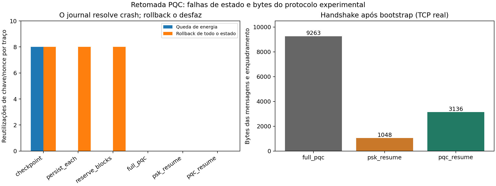

# Resultado: retomada de sessões PQC após reinício

**A hipótese passou nos cenários implementados; a novidade para publicação ainda precisa ser estabelecida.** A retomada autenticada com segredo persistente e ML-KEM novo apresentou zero reutilizações de chave/nonce e 66.14% menos bytes de handshake que o estabelecimento completo deste protocolo experimental.

## 1. Pergunta e decisão

Pergunta: quais garantias dependem de conservar o contador, de conservar uma autoridade de estado ou de estabelecer um segredo assimétrico novo após o reinício?

Mantemos o tema para desenvolver o artigo. O resultado sustenta uma avaliação de falhas e custos. Ele não demonstra um protocolo criptográfico inédito, segurança formal, interoperabilidade TLS ou vantagem energética em ESP32.

## 2. Experimentos e critérios

Foram executados **240 traços**: seis políticas, quatro falhas, 10 repetições independentes com criptografia real. Cada traço transmite 8 leituras antes e 8 depois do reinício. O observador verifica as cifragens antes da decisão do receptor. Checkpoints são arquivos cifrados/autenticados reais, restaurados do disco; a reserva do contador usa fsync e rename.

Também passaram **65/65 verificações funcionais de segurança**, incluindo controles negativos deliberadamente vulneráveis: adulteração de mensagens e limites, replay, identidades não autorizadas, confirmação de chave, expiração, orçamento no gateway, contador esgotado, crash após reserva, perda de estado do gateway e divulgação tardia do PSK. Passar o controle negativo significa demonstrar a falha esperada, não atribuir segurança à política vulnerável.

O Mininet-WiFi executou **30 processos novos de cliente**, uma leitura validada pelo servidor por processo, e restauração do primeiro checkpoint válido nas 9 reinicializações de cada política. Todas as conexões têm os bytes únicos enviados/recebidos confirmados no PCAP por porta e sequência TCP; retransmissões não contam duas vezes nessa verificação. O cliente autentica a confirmação da leitura.

Os critérios foram registrados em manifestos antes da execução: testemunho de falha no controle; unicidade e entrega nas políticas com chave nova; persistência segura com journal preservado e vulnerável quando ele é restaurado; verificações funcionais aprovadas; retomada ML-KEM menor que handshake completo. Todos passaram. **Repetições cobrem novas execuções criptográficas; não são uma prova estatística contra todo atacante.**

## 3. Falhas de estado

Cada célula acumula 10 traços de 8 mensagens após reinício (80 mensagens). “Escritas” conta a fase estável de 8 leituras; exclui provisionamento, inicialização e checkpoint do boot. O orçamento de mensagens aceitas permanece no gateway.

| Política | Reusos: queda de energia | Reusos: rollback completo | Textos recuperados no rollback | Leituras aceitas no rollback | Escritas na fase estável |
|---|---:|---:|---:|---:|---:|
| `checkpoint` | 80 | 80 | 80 | 0 | 0 |
| `persist_each` | 0 | 80 | 80 | 0 | 8 |
| `reserve_blocks` | 0 | 80 | 80 | 0 | 1 |
| `full_pqc` | 0 | 0 | 0 | 80 | 0 |
| `psk_resume` | 0 | 0 | 0 | 80 | 0 |
| `pqc_resume` | 0 | 0 | 0 | 80 | 0 |

Checkpoint antigo provocou repetição de chave/nonce em AES-GCM. Com uma leitura sintética conhecida, a relação entre os dois ciphertexts recuperou integralmente a outra leitura. O gateway rejeitou esses registros repetidos; a rejeição não impediu o vazamento já presente no enlace.

Persistir antes de cada uso e reservar blocos evitaram a falha quando o journal durável permaneceu atual. Restaurar também esse journal reproduziu a falha. Com blocos de 32 e 8 mensagens usadas, a reinicialização salta 24 posições restantes. Essas políticas não fornecem proteção contra rollback integral de memória não volátil sem uma âncora externa.

Checkpoints truncados acionaram estabelecimento completo: 60 fallbacks nos 60 traços dessa falha. As políticas de retomada persistem somente o segredo de retomada; as antigas chaves de tráfego não são gravadas.

## 4. Custo de retomada na rede

| Política | Processos/leituras entregues | Restaurações de snapshot | Mediana de bytes por handshake após bootstrap | Bytes IPv4 capturados, ambas as direções |
|---|---:|---:|---:|---:|
| `full_pqc` | 10 | 9 | 9263 | 109140 |
| `psk_resume` | 10 | 9 | 1048 | 31929 |
| `pqc_resume` | 10 | 9 | 3136 | 51189 |

Os 3136 bytes da retomada ML-KEM são 66.14% menores que os 9263 bytes do handshake completo. Esta é a soma de quatro mensagens JSON/Base64 e seus prefixos de tamanho; não inclui cabeçalhos TCP/IP. A coluna IPv4 inclui os 10 boots, o bootstrap completo, leituras, ACKs e eventuais retransmissões. O bootstrap é excluído apenas da mediana de retomada.

Ambos os comparadores usam ML-KEM-512 efêmero; o completo autentica os dois participantes com ML-DSA-44 e chaves públicas previamente fixadas. A retomada usa o segredo autenticado no bootstrap, com HMAC, e conserva ML-KEM novo. O provisionamento das identidades e o transporte de certificados ficam fora deste modelo para ambos.

Retomada somente com PSK tem garantia distinta: o teste recuperou a leitura passada ao revelar posteriormente o PSK retido. Na variante com ML-KEM novo, a tentativa de decifrar somente com esse PSK falhou. Isso é um teste funcional de separação de chaves, não prova de forward secrecy. Comprometimento do PSK antes do handshake permite impersonação ativa; perda de estado do gateway exige autenticação completa.

## 5. Limites e relação com trabalhos existentes

A autoridade do gateway e a entropia fresca permanecem fora do rollback do cliente. O controle que repete a entropia do cliente e reproduz o handshake antigo regenera a chave na política PSK: a condição de aleatoriedade é essencial. Não foram avaliados rollback simultâneo de gateway e cliente, extração de todas as credenciais, canais laterais, garantia física de apagamento em Python, consumo real de flash, perdas em rajadas ou implantação em ESP32.

AES-GCM exige unicidade de IV por chave ([NIST SP 800-38D](https://csrc.nist.gov/pubs/sp/800/38/d/final)). Recuperação de contexto e persistência de sequências já aparecem em OSCORE ([RFC 8613, seção 7.5 e apêndice B](https://datatracker.ietf.org/doc/html/rfc8613#section-7.5)). TLS distingue retomada PSK pura e com segredo assimétrico novo ([RFC 9846](https://datatracker.ietf.org/doc/html/rfc9846#section-2.2)). Portanto, reservar contadores ou reduzir bytes via retomada não constitui novidade por si só.

O recorte candidato a WQuNets é a avaliação reproduzível das condições de retomada pós-quântica diante de reinício, rollback e divulgação de estado, com custos registrados e controles negativos. A comparação com implementações de protocolos padronizados e a revisão aprofundada de trabalhos relacionados permanecem necessárias antes de sustentar a contribuição de publicação.

## 6. Evidências e reprodução

Campanha de segurança: `results/raw/recovery_security_complete_20261014`.

Verificação de rede válida: `results/raw/recovery_network_complete_20261014`.

SHA-256 dos resultados: segurança `7cc540891a41454d40956c97dae27f3eb32e2e58143b130fc78934ce29917ac1`; rede `98b25ddde69e3fa5d0dd8344360a855d3dc23dc9ced6308986605cc77f24a35e`. Os manifestos contêm hashes dos fontes efetivamente executados; este relatório exige que eles coincidam com a árvore atual. Dados agregados: [resultado_hipotese_retomada.csv](resultado_hipotese_retomada.csv).

As capturas exploratórias anteriores, sem auditoria de todos os bytes por conexão, são excluídas dos números deste relatório. As credenciais e snapshots usados nos testes são temporários e apagados; os resultados públicos não contêm chaves ou leituras em claro.

Comandos e modelo de ameaça: [experimento_retomada.md](experimento_retomada.md).

PSK puro e ML-KEM novo possuem garantias distintas; os bytes não representam TLS interoperável.
