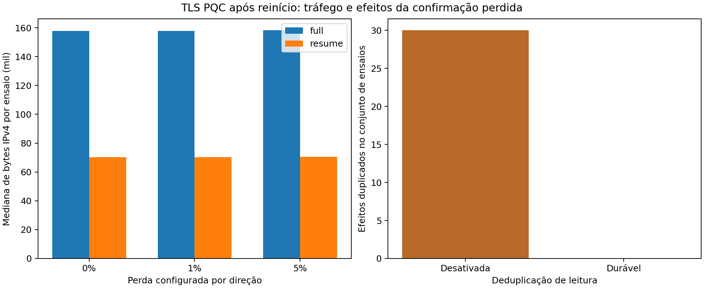

# Resultado: baseline TLS e piloto de recuperação

**Piloto concluído: 60 condições, 360 processos de cliente e 300 entregas lógicas confirmadas.** São cinco blocos por configuração, com modos completo/retomado, deduplicação ativa/desativada e perdas de 0%, 1% e 5%. Cada ensaio tem cinco IDs de leitura e seis tentativas: uma confirmação perdida exige nova tentativa do mesmo ID. IDs/cargas são repetidos entre comparadores; as 300 entregas não são 300 amostras independentes de sensores.

## TLS efetivamente validado

OpenSSL 3.5.9 29 Sep 2026 (Library: OpenSSL 3.5.9 29 Sep 2026); commit `45e844fa2a14ec92d146bd8f5778ac130b6625fb`. Todos os clientes negociaram TLS 1.3, `TLS_AES_256_GCM_SHA384` e `X25519MLKEM768`. No handshake completo houve CertificateVerify ML-DSA-44 nos dois sentidos (código 0x0904), cadeia verificada e nomes `gateway.local`/`iot_1` verificados. O grupo híbrido usa ML-KEM-768 e X25519; não é a mesma suíte da bancada ML-KEM-512. As comparações de TLS são feitas dentro do mesmo backend.

Sessões DER são salvas em checkpoints AES-GCM autenticados, vinculados ao nome do servidor e ao hash da CA. O servidor usa tickets stateful com cache em RAM; 0-RTT está desabilitado e o timeout configurado é 3600 s. Reiniciar o servidor remove o cache, preservando somente o ledger de leituras. Isto não representa um servidor com STEK/cache persistentemente restaurados.

O handshake quente completo teve mediana de **23859 bytes TLS**, contra **2873** na retomada: **87.96% de redução** até a conclusão de SSL_connect. Esta medida não inclui tickets pós-handshake, cabeçalhos IP ou todas as conexões do ensaio. A tabela abaixo inclui todo o tráfego IPv4 observado na interface do servidor. Não reutilizamos os 66,14% do protocolo JSON como resultado de TLS.

## Rede e aplicação

| Perda por direção | Deduplicação | Modo TLS | Bytes IPv4: mediana (mín–máx por bloco) | Segmentos retransmitidos pelo TCP: mediana | ACK após conexão TCP: mediana de medianas (ms) | Leituras lógicas | Efeitos duplicados |
|---|---|---|---:|---:|---:|---:|---:|
| 0% | desativada | full | 157962 (157806–158050) | 0 | 69.2 | 25 | 5 |
| 0% | desativada | resume | 70421 (70161–70421) | 0 | 56.8 | 25 | 5 |
| 0% | ativa | full | 157895 (157739–157947) | 1 | 65.7 | 25 | 0 |
| 0% | ativa | resume | 70250 (70198–70406) | 1 | 55.4 | 25 | 0 |
| 1% | desativada | full | 157962 (157858–158218) | 0 | 67.7 | 25 | 5 |
| 1% | desativada | resume | 70317 (70069–70437) | 1 | 57.4 | 25 | 5 |
| 1% | ativa | full | 157895 (157843–158087) | 1 | 67.2 | 25 | 0 |
| 1% | ativa | resume | 70158 (70050–70446) | 3 | 65.2 | 25 | 0 |
| 5% | desativada | full | 158422 (158258–158474) | 10 | 109.4 | 25 | 5 |
| 5% | desativada | resume | 70545 (70425–70909) | 3 | 83.1 | 25 | 5 |
| 5% | ativa | full | 158287 (158075–158507) | 9 | 91.6 | 25 | 0 |
| 5% | ativa | resume | 70550 (70218–70710) | 7 | 62.1 | 25 | 0 |

O gateway reiniciado provocou **30 handshakes completos** nas condições configuradas para retomar. A restauração de um checkpoint antigo, com gateway vivo, resultou em 30 retomadas no boot 4. A aceitação de um ticket antigo não é, isoladamente, falha de nonce: houve key_share novo em cada conexão. As chaves de tráfego/IVs internos do OpenSSL não foram exportados; a auditoria verifica negociação e compartilhamentos públicos novos, não constitui observação direta de todos os pares chave/nonce do TLS.

Com ACK perdido, o controle sem deduplicação aplicou **30 efeitos duplicados**, contra **0** com deduplicação durável. “Efeito” significa inserção de uma linha `(device,id,digest)` em SQLite; não significa execução exatamente uma vez de um atuador externo. Ambos os modos rastreiam IDs para a auditoria e rejeitam conteúdo conflitante; o controle desativa apenas a supressão de efeitos repetidos.

`WAL` e `synchronous=FULL` persistem a decisão antes do ACK. Os testes cobrem reinício, conteúdo conflitante e rollback de transação. Um controle separado demonstra que restaurar o banco inteiro desfaz a deduplicação; não alegamos resistência a rollback de todo o gateway.

## Auditoria e limites

Há captura PCAP em `h1-eth0` de cada condição. Os fluxos são identificados por sequência inicial TCP e hash do key_share público do ClientHello, porque portas podem ser reutilizadas. Exigimos cobertura contínua do handshake e do registro de leitura; em conexão confirmada todos os bytes TLS coincidem. Na conexão deliberadamente interrompida, um alerta terminal de 24 bytes pode não alcançar o receptor e é contabilizado separadamente. Retransmissões do TCP não são novas cifragens da aplicação.

As perdas netem são independentes nas duas direções do enlace cabeado AP–servidor, com 2 ms de atraso por direção; o sensor usa Wi-Fi emulado. Ordem dos quatro comparadores rotacionada por bloco. Os blocos compartilham a carga lógica, mas não a mesma sequência de perdas do kernel. O campo de ACK mede o intervalo após TCP conectado; `reading_recovery_ms` inclui execução do cliente e tentativas desde o disparo do controlador, no host. O CSV contém a mediana de recuperação por bloco, mas nenhum desses tempos é tempo de boot de ESP32.

Resultados descritivos de piloto, sem inferência de P95 robusto, energia ou desgaste de flash. São um sensor, uma implementação TLS e uma política de cache. A correção funcional não estabelece novidade científica nem prova formal de segurança.

Os segmentos retransmitidos são medidos por `TCP_INFO.tcpi_total_retrans` em ambos os endpoints antes de fechar os sockets. O CSV também registra payload duplicado observado no PCAP, que é somente um limite inferior: a captura após netem pode não observar a primeira cópia descartada. As duas métricas não são intercambiáveis.

O contador cobre também o encerramento TLS e as tentativas deliberadamente interrompidas. Retransmissões presentes em 0% de perda configurada não devem ser atribuídas ao netem. A amostragem ocorre antes do fechamento do socket e não inclui transmissões posteriores.

Dados: `/workspace/results/raw/tls_network_measured_20261014`. SHA-256 de results.json: `f3125012aca0267f78a8525110a66c00d03dc4993c44131cca0064304825eb7e`. Os fontes de execução foram conferidos com o manifesto antes deste relatório. Dados agregados: [resultado_tls_piloto.csv](resultado_tls_piloto.csv).

